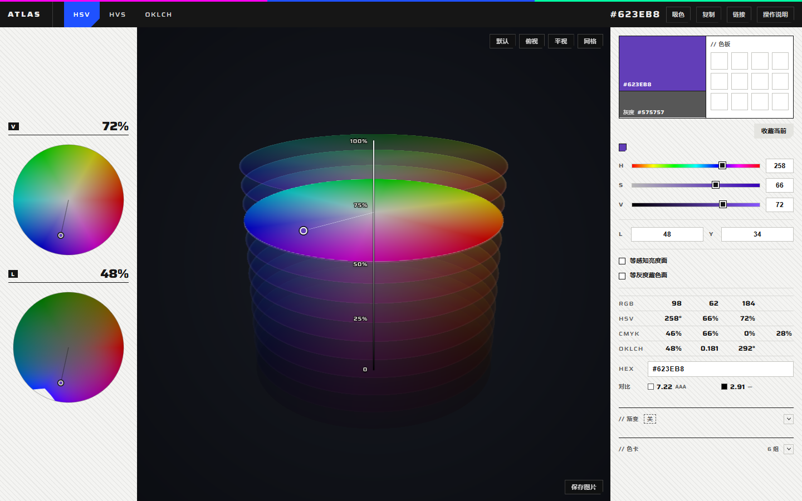

# Atlas · 三维色彩空间取色器（HSV / HVS / OKLCH）

单文件网页程序：把色彩空间画成一支可旋转的立体，直接在立体里点选颜色。顶部命令栏切 **HSV / HVS / OKLCH**，也能从屏幕任意处吸色；左边两块读数（当前切面的俯视 + 一族恒定值），右边一列整备（颜色模块、历史色带、三条坐标、两个切面开关、四套数值与对比度、渐变、色卡）。输入渐变的首尾两端色，可用避灰 / 线性光 / 弧线 / 传统直线四种算法，并把整条颜色路径画进三维色体里；配色可以导出成 CSS / JSON / GPL / ASE。

## 打开方式

在线版：**https://dandelion011.github.io/atlas/**

本地版：双击 `index.html`。两者是同一份文件，无构建步骤、无第三方库、不加载任何外部资源。Chrome / Edge / Firefox / Safari 均可（需要 WebGL）。

## 外观

变体卡（写在 `<html>` 的 `data-ef-*` 上）：

`
强调色 fluoro #1F51FF / 纸色 neutral / 切角 standard / 底纹 hatch / 密度 standard / 动效 calm
主视觉：三维色体视口（整套界面里唯一的深色仪器窗）
页面类型：控制台
`

纸面 `#F4F4F2`、板 `#FFFFFF`、墨 `#161616`、次要墨 `#5C5C5C`、细线 `#D9D9D6`。强调色是**荧光蓝 `#1F51FF`**，只做填充，只出现在当前生效的开关上；它够亮，压在上面的字用白（5.7:1），墨字压上去只有 3.2:1。可点的方块切一个角，不可点的是直角；分区用 1px 细线而不是卡片；没有圆角、投影和装饰性渐变（渐变预览条是内容本身）。底纹是 45° 斜线，压在纸上极淡。

字号只有五档：**9.5**（块里的读数、状态签、摘要）、**10**（字段名、眉标、分段）、**11**（按钮、勾选、标签页）、**12**（所有数字与 HEX 输入）、**16**（顶栏 HEX），另有字标 13、弹窗标题 18、左栏读数 22。拉丁大写标签统一 `.14em` 字距，中文一律 `.02em`，按钮和分段用 `.02em`；线宽两档：细线 `#D9D9D6` 分区，墨色 1px 用于结构边界（栏与栏、模块框、表头）。

拉丁字体用 **Saira**（可变字体，宽度轴 50–125），已裁成拉丁子集以 woff2 内嵌在 `index.html` 里（约 55 KB），打开就生效、不外链；中文落系统的苹方 / 微软雅黑。字段和小标签用 112% / 125% 的宽度，数字一律等宽。只有浅色一套，没有加深色主题。

## 三个色彩空间

顶部 `HSV` `HVS` `OKLCH` 三个标签，当前那个整块荧光蓝、白字、右下切角。当前颜色的几套坐标始终同步，切换不丢色。每个空间各自记住自己的视角——旋转和缩放互不影响。

| | 竖直轴 | 半径 | 角度 |
| --- | --- | --- | --- |
| **HSV** | 明度 **V** | 饱和度 **S** | 色相 **H** |
| **HVS** | 饱和度 **S** | 明度 **V** | 色相 **H** |
| **OKLCH** | 感知明度 **L** | 彩度 **C** | 色相 **H** |

- **HVS** 是 HSV 的另一种摆法：把 S 和 V 的位置对调，每一层是等 S 面——盘心是 V=0 的黑、盘缘是 V=100 的纯色，纵轴刻度读的是饱和度。它是独立的一个标签，不再藏在别处的小开关里。
- HSV 的实体是熟悉的圆柱形状：顶部整个色轮、底部收成黑点。和 OKLCH 一样用切片层叠绘制，共 15 层：每片沿边缘描一圈，颜色是该明度在纵轴上的颜色，所以能看出一层层的圆盘。
- OKLCH 画的是 **sRGB 色域本身**——每个明度上能到的彩度不同（黄色能很亮很艳，蓝色一艳就暗），所以是上窄下宽、中间鼓出来的不规则体，不是圆柱。实现上是 30 层等 L 切片的层叠：每片都保留一圈亮边，所以层层分明；当前 L 那层高亮并带网格。每片边缘都由解析判定得出，光滑无锯齿。
- 中间那张面是当前竖直坐标的横切面：HSV 下是等 V 圆盘，OKLCH 下是色域在该 L 上的截面。**等感知亮度面 / 等灰度藏色面**两个开关在右栏 L、Y 两个目标值下面，勾上就把横切面换成对应的曲面。

## 左侧：两块读数

每块上面一行是 **字母标签 + 宽体数字**，下面就是那张图；标签本身就是这张面的名字，不再另写说明。

- **上格**——模型中间那张切面的俯视：HSV 是 **V**（等 V 圆盘，当前 V 的整圈色轮），HVS 是 **S**，OKLCH 是 **L**（等 L 面上的 C×H 截面）。
- **下格**——HSV / HVS 是 **L**：所有**看起来一样亮**的颜色，黄绿在这里明显变暗、蓝变亮，到不了的色相/饱和度直接留空；OKLCH 是 **C**：所有彩度相同的颜色（角度是色相、半径是 L），达不到这个彩度的明度留空。

同一个空间里，上格永远跟着模型当前那张切面走，下格永远是"另一个恒定值"的家族。**点一下或拖动可以取色**：上格保持竖直坐标只改另两个，下格保持它自己恒定的那个量（L 或 C）。

## 右侧：整备栏

自上而下：

1. **颜色模块**——左边一半是当前色（上 2/3）和它的去色（下 1/3）。两块左下角各写着 HEX，字色按所在颜色的亮度自动翻黑或翻白；下面那块前面标着「灰度」，一眼分得出哪块是原色、哪块是转灰度的结果。右边一半是 `// 色板`：四列格子，只保存点「收藏当前」的颜色，存在 localStorage，还没有颜色时这些格子就是空位。在模型里取色、拖渐变条、在左侧读数里取色都不会自动写入色板。模块下面一行是动作：取色模式时左边出现蓝块提示 `取首色 / 取尾色` 和「取当前」，右边始终是「收藏当前」。
2. **历史色带**——颜色模块下面一排 14px 的小方块，按用过的顺序排开（最新在最右，当前那个描边加粗）。点任意一格回到那个颜色，`⌘Z / Ctrl+Z` 退回上一步；超过 24 个从头挤掉。
3. **三条坐标**——H / S / V，切到 OKLCH 后整组换成 **H / C / L**（标签、量程、轨道配色都换，C 是 0–0.4 的彩度），滑块轨道本身按当前颜色着色。
4. **L / Y 目标值**——直接填一个数，就把当前色改成感知亮度 L 或灰度值 Y 正好是这一级的颜色；改 Y 时先在当前 S 下二分 V，V 顶到 100 仍够不到就退到 V=100 上二分 S，所以任何灰度都能取到。
5. **等感知亮度面 / 等灰度藏色面**——两个开关互斥，勾上就把视口中间那张横切面换成 `L(color) = 当前 L` 或 `Y(color) = 当前灰度` 的曲面；再点一次回到等 V 平面。OKLCH 下横切面本身就是等 L，两个都置灰。
6. **四套数值**——RGB / HSV / CMYK / OKLCH 各一行，等宽数字右对齐；下面是可直接编辑的 HEX，再下面一行 **对比度**：当前色对白、对黑各一个 WCAG 比值，跟 `AAA`（≥7）/ `AA`（≥4.5）/ `大字`（≥3）的等级。
7. **`// 渐变`**——标题行一条墨线，默认收起。展开后如果 `// 色卡` 也开着，可以把色卡或色板里的色块**直接拖到渐变条上**：拖动时条上会出一条落点线，松手就在那个位置插一个该颜色的停靠点。
8. **`// 色卡`**——六组预设的配色（高级灰 / 荧光色 / 莫兰迪 / 复古胶片 / 深海 / 纸与墨），一行一组：名字在左，六个色块在右，点任一色块直接把它变成当前色；色块也能拖到渐变条上。底部「把色板存成色卡」把色板里收藏的颜色存成自己的色卡（最多 8 色、最多 12 组，存在 localStorage），自建那几行右侧有 `×` 可以删。最下面一行是导出，把**当前色板 + 全部自建色卡**一起写成 CSS 变量 / JSON / GPL / ASE（ASE 给 Photoshop、Illustrator，GPL 给 GIMP、Krita、Aseprite）。默认收起，标题行右侧显示组数。

## 视口上的操作

三维视口是整套界面里唯一的深色窗口，落在它身上的操作贴在角上：

| 位置 | 内容 |
| --- | --- |
| 右上 | 默认 / 俯视 / 平视 三个视角预设，和「网格」开关（生效时整块荧光蓝） |
| 右下 | 保存图片：把当前视图导出成 PNG（含渐变路径） |
| 顶栏右侧 | 当前 HEX、吸色（系统取色器，从屏幕任意处取）、复制、链接、操作说明 |

「吸色」用的是浏览器原生的 `EyeDropper`，Chrome / Edge 才有；不支持时这个按钮直接不显示。「复制」和「链接」在 560px 以下收起，把位置让给色值和说明。

## 渐变与路径

渐变模块**默认不启用、也默认收起**：展开后勾上「启用」，这条渐变才会画进三维色体；关掉就只剩色体本身，路径与死区一并消失。预览条本身始终按真实颜色显示，不因为没启用就调淡——「开 / 关」由标题行的状态签说明。

渐变由至少两个停靠点组成。双击渐变条空白处新增一个（取当前位置的颜色），拖动条上的方块改位置，双击方块或选中后按 `Delete` 删除；首尾固定在 0% 和 100%，不能删除。新增的停靠点以 `中1`、`中2` 的形式并排列在首 / 尾下面。

**从色卡拖过来**：把色卡（或色板）里的任意色块拖到渐变条上，条上会出一条落点线，松手就在那里插一个该颜色的停靠点——离已有停靠点太近（<1.2%）就放弃，最多 16 个。

改颜色有两条路：选中停靠点后点它旁边的色块进入取色模式，再点色板颜色、取当前，或拖拽模型 / 俯视图；或者在三维视口里直接按住路径上的方块拖拽——只有指针落在方块 13px 内才会抓取。

每个相邻停靠点之间各自跑一遍算法，所以多停靠点下的避灰是「每段各自绕一次色相」，接缝处会有一次方向折点。

算法行有四种：

- **避灰**：在 **OKLCH 极坐标**里插值——L、C 线性走，H 按 `方向` 走近路或远路。因为走的是极坐标，彩度不会像直角插值那样在中段塌到接近 0（蓝→橙最低仍有 `C≈0.13`，直角插值会掉到 `0.009`），路径绕开中性轴。短弧走品红那一侧、长弧走青绿那一侧。
- **线性光**：把 sRGB 解码到线性光后插值，再编码回去，相当于两束光相加。选中后会多出一行 `强度`：`激进`（默认）在中段额外提亮，`保守` 是标准线性光。
- **弧线**：在 HSV 色盘上按最短角向走 H，S 和 V 线性变化。S 相等时是圆弧；S 不等时半径随角度线性变化，成为**阿基米德螺旋**。选中后（或死区打开时）会多出一行 `方向`。
- **传统直线**：sRGB 逐通道插值，也就是浏览器默认的 `linear-gradient`，不补任何颜色——蓝→橙的中段会重新变成灰，用来和避灰对照。

中央三维视口里的彩色线就是当前渐变路径：首 / 尾是两端，中间停靠点是方块。切 HSV / OKLCH 看同一条路径的不同形状——HSV 里 V 可能先下陷，OKLCH 里它就是一条上拱的亮弧。

### 导出

渐变卡片底部有三个按钮，都只复制到剪贴板：

- `CSS` —— `background: linear-gradient(90deg, …);`，49 个 stop，直接可用。
- `SVG` —— 1200×600 的 SVG 文本，粘进 Figma / Sketch / Canva 就是一条可编辑的渐变。
- `链接` —— 把全部停靠点（`st=`，形如 `RRGGBB@万分比`）、算法、方向、线性光强度、死区参数写进 URL，打开链接即还原同一个渐变。

### 死区

**死区属于渐变模块**，只服务渐变，收起时一并隐藏。死区自己又是一层折叠（默认收起），折叠时标题行右侧显示 开 / 关 状态；展开后先勾 启用，再调 H / S / V。默认关闭，默认区间是 **H 0–360、S 0–20、V 20–90**，针对低饱和、中等明度的发灰色。

开启后模型里出现的是一块**半透明灰色体积**：只有投影轮廓、一层很淡的描边和「死区」标签，不画内部结构线。

如果原算法路径会进入死区，只有**被切开的这一段**会被改写：在区间内用一条和原路径**切线相接**的三次曲线送过去——两端的位置和方向都与原算法一致，所以接回原路径处没有折角；再把死区最「薄」的那一维往外推一点，保证确实绕开。首 / 尾两个端点保持原色；H 区间支持 `350–10` 这种跨 0° 的写法。

## 明度 V 与感知明度 L

- **V** 是 sRGB/HSV 的数值刻度，等步长的 V 看起来并不等亮。
- **L** 是 OKLab 的 Lightness，按人眼感知均匀分布，L 相同 = 看起来一样亮。
- **Y** 是转灰度后的相对亮度，等灰度藏色面上素描关系完全一致，颜色怎么换都不破坏明暗结构——这正是「藏色」要的效果。L 和 Y 是两个不同的量：黄和蓝在两者上的排序并不一致。

## 交互（每个键位只做一件事）

| 操作 | 效果 |
| --- | --- |
| **中键拖拽** | 旋转视角（触屏上改为拖空白处） |
| 滚轮 | 缩放 |
| **左键** | 只取色：落在切面上取色相/饱和度或彩度，落在实体表面取该表面颜色；点到空处不动作。拖动时若拖出边界，按以盘心为圆心的极坐标压回边缘——角度照旧跟手，半径钉在边界上，所以绕圈拖是连续换色而不是卡住。等感知亮度面 / 等灰度面上没有圆盘边界，改成先朝模型轴线压回，压不中再找最近的面点，效果一样是贴边不跳 |
| **右键上下拖** | 只改竖直坐标（V / S / L）；视口和左栏两张读数图都认这个手势 |
| 双击视口 | 复位视角 |
| 左侧读数 | 鼠标左键点击或拖动取色；右键上下拖改竖直坐标 |
| `⌘Z` / `Ctrl+Z` | 退回上一个用过的颜色（在输入框里不抢） |
| 色块拖到渐变条 | 落点插一个该颜色的停靠点 |

## 链接参数

命令栏的「链接」一键复制**完整状态**：颜色、空间、视角、两个切面、渐变（含模式、停靠点、死区）、色板、哪几个模块展开。它先把当前网址上的参数清空再重写，所以旧链接里的残留参数不会带进来。

| 参数 | 含义 |
| --- | --- |
| `?c=FF5FA2` | 当前颜色 |
| `?space=oklch` / `?space=hvs` | 直接进 OKLCH / HVS（HSV 是默认，省略） |
| `?view=top\|side` | 视角预设 |
| `?cam=yaw,pitch,dist` | 自由视角（覆盖 `view`），`dist` 范围 2.0–7.6 |
| `?lum=1` / `?gray=1` | 开等感知亮度面 / 等灰度藏色面 |
| `?ga=3FB8F5&gb=FF7A2F` | 渐变两端色 |
| `?st=RRGGBB@t,…` | 全部停靠点（t 为万分比），优先于 `ga / gb` |
| `?gm=avoid\|light\|arc\|linear` | 渐变算法 |
| `?gd=short\|long` | 色相走近路 / 远路 |
| `?gl=radical\|calm` | 线性光的激进 / 保守 |
| `?gz=h0,h1,s0,s1,v0,v1` | 死区区间 |
| `?p=RRGGBB,…` | 色板（最多 12 个），加载时**替换**当前色板，不写 localStorage |
| `?open=grad,card` | 打开哪几个折叠模块 |

单项参数照样能手写组合，例如 `?space=oklch&c=22C1A0&view=top&ga=3FB8F5&gb=FF7A2F`。默认视距按空间分别设置：HSV `5.0`，OKLCH `3.0`；切换空间不会覆盖另一套视角。

## 实现要点

- 三维实体全部在**一个 fragment shader** 里解析/步进求交：HSV 是解析圆柱 + 平面切片；OKLCH 用隐式场 `C - Cmax(L,H)` 沿射线找色域边界（掠射时用三分法找最近点，避免轮廓阶梯）。
- `Cmax(L,H)` 用 JS 预计算成 128×64 查找表上传成纹理（POT + REPEAT 才能在色相方向环绕），JS 与 shader 共用同一张表，取色和渲染严格一致。
- 等感知亮度面同样是隐式等值面 `L(色) - L当前`，符号变化 + 二分求交；S/V 互换时同一个函数改用半径=V、高度=S 的映射；OKLab 的 `pow/cbrt` 直接在 shader 里算。
- 左侧两张俯视图按角度/半径逐像素算色：等 V 面直接取色，等 L 面沿 V（或沿 L）二分求出对应坐标，到不了就留空。竖直坐标变化时才重画，限流 ~9fps。
- 画布按设备像素渲染，不做超采样：所有抗锯齿都按屏幕导数或像素实际尺寸计算（切片边缘、色域边界、俯视图圆边各一像素过渡）。
- 渐变四种算法共用同一个采样出口：`避灰` 在 OKLCH 极坐标里插值；`线性光` 在线性 RGB 里插值，激进档再叠加一个中段提亮钟形；`弧线` 在 HSV 极坐标里走最短 H 角向；`传统直线` 在 sRGB 三通道插值。预览条与三维路径共用同一个采样函数。
- 死区在采样出口先按 96 段找出被切开的局部区间，只改写这些区间，区间外直接返回原算法结果。区间内在 HSV 里做一条三次 Hermite：端点取区间两端、切线取原路径在端点的差分，因此接回原路径处位置和方向都连续；再沿死区最薄的一维叠加一个 `sin²(πu)` 凸起。首 / 尾端点不参与过滤。预览条取 49 个 stop，三维路径取 97 个样本。
- 三维路径和死区都不进 fragment shader，而是用一张与视口同尺寸的 2D overlay canvas：按当前空间映射成世界坐标，再用同一台相机投影。路径是深色外框 + 浅色内框 + 彩色芯；死区是边界点投影后的凸包，填一层半透明灰并描一圈淡边。
- 界面是纯 CSS 的网格：顶栏 46px + 台面三列（读数 / 视口 / 整备）；窄屏下整台设备竖排，视口 52dvh，下面的列随页面滚动。
- 历史色带是 24 格环形：颜色**稳定 300ms** 才记一笔，所以拖模型、拖渐变条的过程不会把历史灌满；跳回历史时用 `noHist` 标记跳过记录，不会再补一笔。
- ASE 是手写的二进制：`ASEF` + 版本 + 块数，每组一个 `0xC001` 组头、若干 `0x0001` 色块（`'RGB '` + 三个 float32）、一个 `0xC002` 组尾。没有第三方库。

## SAI2 插件（本分支）

`feat/sai2-plugin` 分支把 ColorWitch 做成 PaintTool SAI Ver.2 里的取色面板：三维取色 → 直接写进 SAI2 前景色，SAI2 改色面板也跟着变。普通 `index.html` 完全不受影响。

安装与用法见 [plugin/README.md](plugin/README.md)，颜色桥的逆向细节见 [plugin/docs/BRIDGE.md](plugin/docs/BRIDGE.md)。

