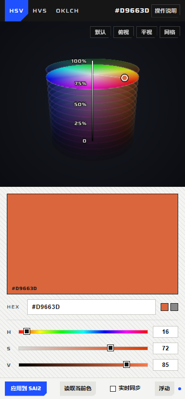

# ColorWitch for SAI2

把 ColorWitch（三维色彩空间取色器）做成 PaintTool SAI Ver.2 里的一块取色面板：在面板里转立体取色，点一下就把颜色送进 SAI2 的**前景色**；SAI2 里换了颜色，面板也跟着变。

不改 SAI2 本体、不替换 DLL、不注入进程——面板是独立程序，通过 SAI2 自己的颜色流程写前景色。



## 安装

要求：
- Windows 10 / 11 x64
- **.NET 10 Desktop Runtime**（开发机装 SDK 就自带）
- **WebView2 Runtime**（Win11 自带；Win10 一般随 Edge 安装）
- 目标 SAI2：`PaintTool SAI Ver.2 (64bit) Alpha.2026.10.19`（PivInk 汉化版，exe sha256 `FF227172…A15F`）。其它版本可以打开面板、读取当前色，但**写色会拒绝**并给出提示。

在仓库里先构建，再安装到 SAI2 程序目录：

```powershell
.\plugin\build.ps1
.\plugin\install\install.ps1 -Sai2Path 'F:\[PivInk]SAI Ver.2'
```

安装只会在 SAI2 程序目录下新建 `ColorWitch\` 子目录并注册一个开始菜单快捷方式，不写注册表、不改 SAI2 文件。

卸载：

```powershell
& 'F:\[PivInk]SAI Ver.2\ColorWitch\uninstall.ps1'
```

## 使用

1. 先打开 SAI2。
2. 打开 **ColorWitch for SAI2**（开始菜单，或安装目录里的 `ColorWitch.Sai2.exe`）。
3. 面板自动贴到 SAI2 客户区右侧，跟随 SAI2 移动 / 缩放 / 最小化；`Ctrl+Alt+C` 显示或隐藏。
4. 在面板里取色：
   - **中键拖拽**旋转色体、**滚轮**缩放、**左键**在色体/切面上取色、**右键上下拖**改竖直坐标（V / S / L）；
   - 顶部切 `HSV / HVS / OKLCH`，底部 H/S/V（OKLCH 时 H/C/L）滑条与 HEX 输入同步；
   - 点 **应用到 SAI2** 写入前景色；
   - 勾 **实时同步** 后，拖拽取色会以 ≤30Hz 连续写进 SAI2，松手补一次落定值；
   - **读取当前色** 把 SAI2 当前前景色读回面板（SAI2 里用吸管/色轮改色时也会自动跟随）。
5. **贴靠 / 浮动**：贴靠时面板是 SAI2 的附属窗口（不出现在任务栏、随 SAI2 最小化）；浮动时是独立窗口，可拖标题条移动。

## 它怎么工作

面板本体是 WPF + WebView2，页面就是 ColorWitch 的 `index.html`（`?embed=1` 时由宿主注入 `embed.css` / `embed.js` 变成 380 宽的面板布局，普通打开 `index.html` 完全不受影响）。

颜色桥写在 `plugin/host/Sai2Bridge.cs` + `Sai2Memory.cs`：

- **读**：读 SAI2 进程 `.data` 里打包的 `0xAARRGGBB` 前景色；内存不可读时降级为读颜色面板里 R/G/B 数值控件。
- **写**：把颜色换算成 SAI2 自己的 VHSV（`V,S,H` 三个 float），写进 SAI2 的颜色状态，再在 SAI2 里起一个远程线程调用它**自己的**「应用前景色」例程——所以色轮标记、SV 方块、R/G/B 字段、色板、笔刷预览都会像用户手动点选一样刷新。
- 偏移量按 exe SHA-256 白名单校验，版本不符直接拒绝写内存；失败时把 HEX 复制到剪贴板兜底。

细节（RVA、失败模式、压测数据）见 [docs/BRIDGE.md](docs/BRIDGE.md)。

## 已知限制

- 面板里没有：色板收藏、渐变编辑、色卡、L/Y 目标值、等亮度/等灰度切面、四套数值、对比度、导出、两张俯视图、保存图片、吸色/复制/链接。要用这些，直接打开普通版 `index.html`。
- 只验证了 `Alpha.2026.10.19 64bit` 这一个 SAI2 版本；换版本后写入会被版本守卫拒绝（面板仍可读色、复制 HEX）。
- 如果 SAI2 以管理员权限运行、面板不是，Windows 会拦跨权限的内存访问，此时只能复制 HEX 到剪贴板。
- 颜色空间坐标沿用 ColorWitch 的模型；写进 SAI2 的是 8bit sRGB。

## 开发

```
plugin/
├── host/                 C# WPF + WebView2 宿主（ColorWitch.Sai2.exe）
│   ├── MainWindow.xaml   面板窗口 / 贴靠跟随 / 热键
│   ├── Sai2Bridge.cs     找 SAI2、版本校验、读/写颜色、消息协议
│   ├── Sai2Memory.cs     ReadProcessMemory / WriteProcessMemory / 远程线程
│   └── Native.cs         Win32 封装
├── embed.css / embed.js  注入 index.html 的面板布局与宿主桥
├── build.ps1             构建 → plugin/dist
├── install/              安装 / 卸载脚本
└── docs/                 PANEL.md（嵌入实现）、BRIDGE.md（颜色桥）
```

调试：
- 离线 UI 调试：用浏览器打开 `index.html?embed=1`，`embed.js` 走 mock 宿主；
- 宿主自检：`ColorWitch.Sai2.exe --get-color` / `--set-color #RRGGBB` 直接输出 JSON（不建窗口）；
- Win32 机制自检：`ColorWitch.Sai2.exe --selftest-memory` 打开一个临时子进程，验证 OpenProcess / ReadProcessMemory / WriteProcessMemory / CreateRemoteThread 这条链路（用于确认 P/Invoke 声明，不碰 SAI2 内存）；
- `CW_DEBUG=1` 在 exe 同目录写 `ColorWitch.Sai2.log` 与 `panel-capture.png`（WebView2 截图），`CW_SELFTEST=1` 额外跑一次「宿主 ↔ 面板」消息自检；`CW_OFFSCREEN=1` 把面板放到屏幕外，不抢前台。

### 验证状态

| 项 | 状态 |
| --- | --- |
| 面板嵌入布局 / 消息协议 / 贴靠跟随 | 宿主机上离屏实测通过（截图 + 日志） |
| 读 SAI2 前景色（内存或窗口字段两条路） | 对运行中的 SAI2 实测通过 |
| 写 SAI2 前景色（Python 参考实现，同一套 RVA/公式） | 200 次/轮 × 4 轮全部成功，界面刷新正常 |
| 写 SAI2 前景色（本 C# 宿主） | 本机实测通过：`--set-color #2288FF` 写入后 SAI2 的 R/G/B 字段变成 034/136/255；面板里点「应用到 SAI2」也实测把 SAI2 前景色改成 #3366CC（色轮/字段同步刷新）。开发沙箱对跨进程打开的权限时有时无，连续压测数据以 Python 参考实现（4×200 次全成功）为准 |

