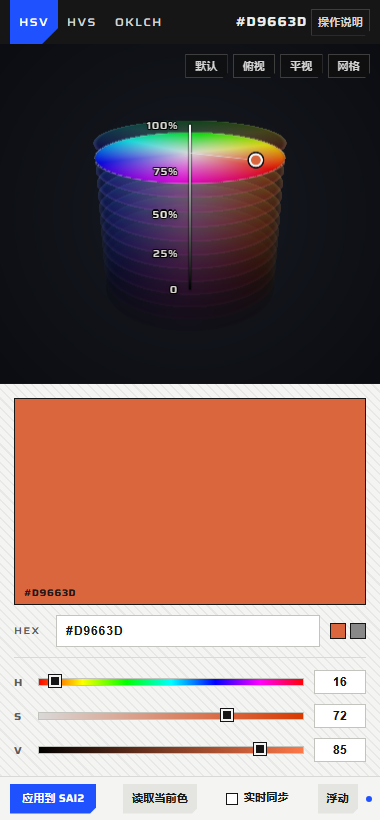
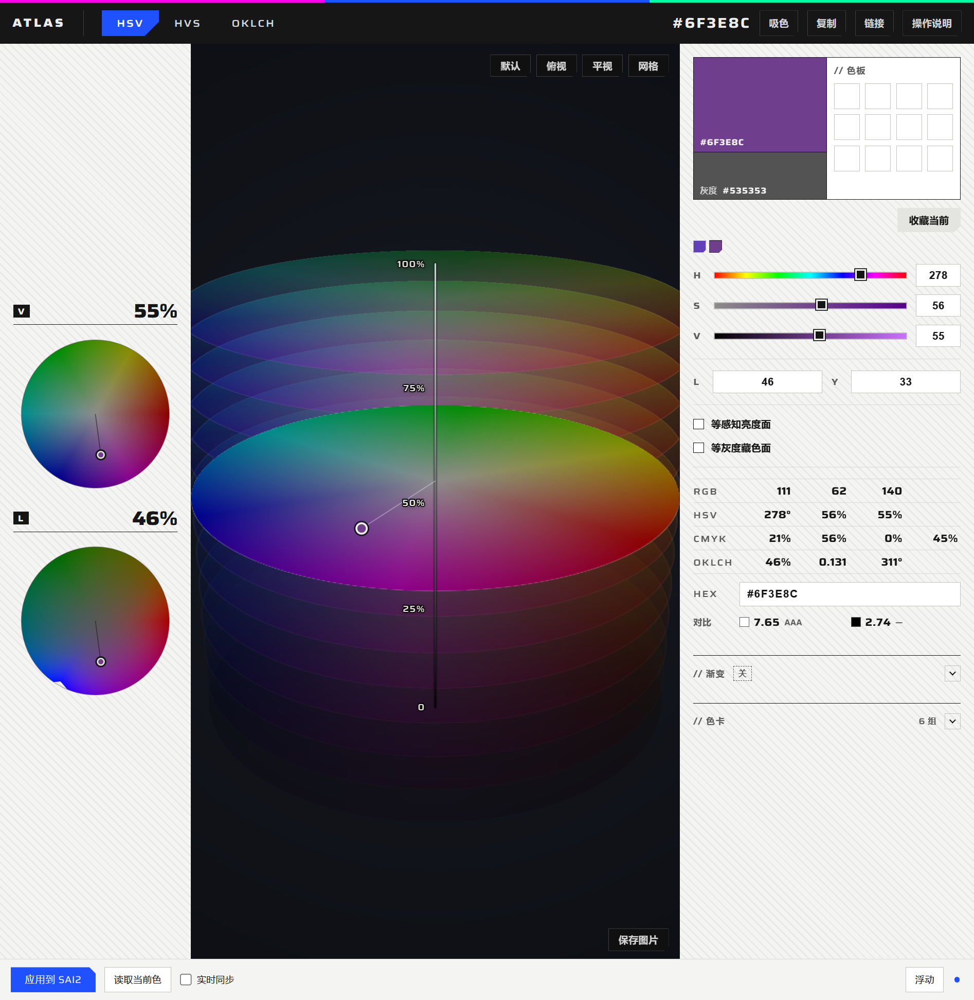

# 面板嵌入实现（embed.css / embed.js）

把原版 `index.html` 变成 SAI2 面板：**不改页面结构、不隐藏功能**，只在页面外面加一条 SAI2 操作条，并接入宿主消息桥。

## 宿主注入顺序

宿主（`Atlas.Sai2.exe`）用 `https://atlas.app/` 虚拟主机加载 `index.html?embed=1`，在 `NavigationCompleted` 之后：

1. `ExecuteScriptAsync(prelude)`：挂 `window.__atlasLog`，把页面里的 `error` / `console.error` / `console.warn` 转进宿主日志（只在 `ATLAS_DEBUG=1` 时写文件）。
2. 注入 `<style id="atlas-embed-style">`，内容是 `embed.css`。
3. `ExecuteScriptAsync(embed.js)`：挂 `html.atlas-embed`、量命令栏高度、建 `#atlasBar`、接桥、加导出拦截。
4. 宿主推 `sai2:state` / `sai2:color` 做首次同步。

`embed.js` 自身也判断 `?embed=1`，普通打开 `index.html` 时直接返回，没有任何副作用。

## 嵌入后页面做了什么

| 改动 | 说明 |
|---|---|
| `html` 加 `.atlas-embed` | `embed.css` 的所有规则都挂在这个 class 下 |
| 量 `header.cmd` 高度 → `--atlas-cmd-h` | 命令栏在窄宽度会换行，内容区按实际高度算 |
| `#deck` 高度 = `100dvh − 命令栏 − 底栏` | 页面自己的滚动（`#panel` / `#deck`）继续工作 |
| 底部加 `#atlasBar` | 应用到 SAI2 / 读取当前色 / 实时同步 / 贴靠 / 状态点 |
| 接 `window.__atlasFromHost` | 宿主推来的状态与颜色 |
| 拦截 `<a download>` 点击 | 导出交给宿主保存（见下） |

**没有移动、隐藏或删除任何原页面模块。** 380 宽时靠页面自己的 `@media (max-width:940px)` 变成单列滚动；1180 宽时是原版三栏。

## 两档布局

| 档位 | 宽度 | 布局 |
|---|---|---|
| 紧凑 | 380（窗口 DIP） | 单列滚动：命令栏 → 视口 → V/L 读数盘 → 色板/滑条/L·Y/切面/数值/HEX/对比度/渐变/色卡/导出 |
| 完整 | SAI2 客户区宽 − 40（≤1440） | 原版三栏：读数盘 / 视口 / 整备栏 |

标题条的「完整 / 紧凑」按钮切换（`LayoutButton`），面板高度始终跟随 SAI2 客户区。两档下功能完全一致，只是排布不同。

## 颜色桥（宿主 ↔ 页面）

页面 → 宿主：

- 拖拽三维视口或滑条时按 ≤30 Hz 发 `{type:'app:apply', hex, live:true}`，松手补一条 `live:false`；同一色值去重。
- 点「应用到 SAI2」/「读取当前色」/「贴靠」分别发 `app:apply{live:false}` / `app:pick` / `app:toggleAttach`。

宿主 → 页面：

- `sai2:state{attached,visible,bridge}` → 底栏按钮文案与状态点（ok 荧光蓝 / unsupported 灰 / error 红）。
- `sai2:color{hex}` → 写进 `#hexIn` 并派发 `input`，页面自己的换算/校验接管；600 ms 内不吃回自己的推送（避免抖动）。
- `apply:ack{ok}` → 主按钮反色 120 ms。

## 导出 / 保存图片

原页面导出（CSS / JSON / GPL / ASE / 保存图片）都是「造一个 `<a download>` + Blob URL → `a.click()`」。WebView2 的下载策略随环境而变，因此 `embed.js` 在 document 捕获阶段拦截带 `download` 的锚点：

1. `preventDefault()`；
2. `fetch(blobUrl)` → `FileReader.readAsDataURL`；
3. `postMessage({type:'app:save', name, mime, data})`；
4. 宿主弹 `SaveFileDialog` 写文件，回 `save:ack`。

这样导出不依赖浏览器下载行为，任何嵌入式环境都能用。

## 宿主提供的运行环境

| 能力 | 说明 |
|---|---|
| 来源 | `https://atlas.app`（`SetVirtualHostNameToFolderMapping` 指向安装目录） |
| 安全上下文 | 是（`EyeDropper` 可用，实测 `typeof EyeDropper === "function"`） |
| 剪贴板 | `navigator.clipboard.writeText` 可用（复制 HEX / 复制链接 / 复制渐变） |
| `localStorage` | 可用（色板、自建色卡持久化） |
| WebGL | 可用（三维视口） |
| 缩放 | 跟随系统 DPI，页面按 CSS px 响应式 |

## 验证记录（离屏窗口 + WebView2 截图/探针）

- 380 CSS 宽：`missing=0`，`hidden` 只出现在原页面默认折叠的渐变/色卡内容与关闭中的说明对话框；`deck` 可滚动到底（scrollHeight 1388 > 640）；无横向滚动。
- 1093 CSS 宽（完整档）：三栏布局，全部模块可见；`missing=0`。
- 能力探针：`localStorage=true`、`eyeDropper=function`、`clipboard=true`、`webgl=true`。
- 导出：CDP 真实点击「保存图片」→ 宿主写出 `exports\atlas-<hex>.png`（183 KB，可打开）。
- 颜色桥：宿主推 `#3366CC` → 页面 `#cmdHex`/`#hexIn`/大色块同步；点「应用到 SAI2」→ 宿主收到 `app:apply`。
- 贴靠：面板窗口贴在 SAI2 客户区右侧 8px，高度随 SAI2 客户区。
